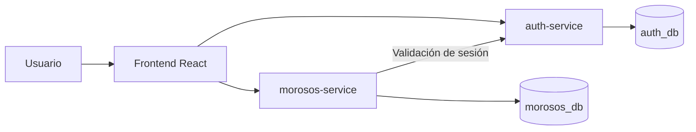

<div align="center">

# AOSC · Gestión de Morosidad

**Información clara para gestionar deudas y entender la recaudación.**

Seguimiento de cuentas · Facturación · Recaudación


[El proyecto](#el-proyecto) · [Arquitectura](#arquitectura) · [Inicio local](#inicio-local) · [Documentación](#documentación)

</div>

---

## El proyecto

Aplicación de AOSC para centralizar la información de cuentas e inmuebles, acompañar la gestión de morosidad y analizar la evolución de la facturación y los pagos.

Combina herramientas operativas de seguimiento con una vista ejecutiva de los resultados: desde indicadores y gráficos generales hasta el detalle de las cuentas y facturas que componen cada importe.

> La aplicación registra y analiza información importada del sistema de origen. No emite facturas ni procesa cobros directamente.

## Qué permite hacer

| Área | Alcance |
| :--- | :--- |
| **Cuentas e inmuebles** | Consultar titulares, ubicación, grupo, distrito y situación de deuda. |
| **Seguimiento** | Gestionar etapas, actuaciones e historial de las cuentas. |
| **Cargas** | Importar información, detectar registros nuevos y actualizar cambios con su correspondiente detalle. |
| **Reportes** | Analizar facturación y recaudación, explorar sus movimientos y exportar información. |
| **Administración** | Configurar parámetros operativos y controlar el acceso mediante usuarios, roles y permisos. |

### Una lectura consistente de los datos

- **Consumos, planes de pago y otros:** categorías diferenciadas para interpretar la facturación y los cobros.
- **Facturación de consumos:** se asigna al mes siguiente al período; por ejemplo, `06/2025 → 07/2025`.
- **Planes y otros:** se asignan por su fecha de emisión cuando está informada.
- **Recaudación:** se analiza por la fecha real de pago.
- **Cumplimiento:** compara pago y vencimiento; pagar el día del vencimiento cuenta como en término. Sin vencimiento informado, el pago queda sin clasificar.
- **Cuentas distintas:** una cuenta que paga varios conceptos se cuenta una sola vez en el total del rango.
- **Cuentas de prueba:** se excluyen de los reportes.

Los planes pueden refinanciar consumos previamente facturados. Por eso se muestran separados y el total combinado no debe interpretarse como nueva deuda.

## Arquitectura



| Componente | Responsabilidad | Puerto local |
| :--- | :--- | :---: |
| `frontend` | Interfaz web, gráficos y consultas operativas. | `5173` |
| `auth-service` | Identidad, sesiones, usuarios y permisos. | `8080` |
| `morosos-service` | Gestión operativa, importaciones y reportes. | `8081` |
| PostgreSQL | Bases separadas para autenticación y gestión. | `5432` |

### Stack

**Backend:** Java 21 · Spring Boot 3.3.5 · Spring Security · JPA/JDBC · Maven · Flyway.

**Frontend:** React 18 · TypeScript · Vite · Tailwind CSS · shadcn/ui · Radix UI · Recharts.

**Datos:** PostgreSQL 16, con migraciones SQL versionadas. Hibernate valida el esquema; Flyway aplica su evolución.

## Estructura del repositorio

```text
.
├── auth-service/       # Autenticación y administración de accesos
│   ├── pom.xml
│   └── src/
├── morosos-service/    # Gestión, cargas y reportes
│   ├── pom.xml
│   └── src/
├── frontend/          # Aplicación React + TypeScript
│   ├── package.json
│   └── src/
├── docs/              # Documentación técnica y funcional
└── README.md
```

## Inicio local

### Requisitos

- **JDK 21**, con `JAVA_HOME` configurado.
- **PostgreSQL 16**, iniciado y accesible.
- **Node.js y npm**. Entorno local de referencia: Node `22.20.0` y npm `10.9.3`.
- Maven Wrapper incluido en cada microservicio; no es necesario instalar Maven por separado.

### 1. Preparar las bases

Crear las bases `auth_db` y `morosos_db` y configurar las credenciales de cada servicio. El usuario de conexión necesita permisos para ejecutar sus migraciones de Flyway.

Las propiedades estándar permiten configurar ambos servicios mediante el entorno:

| Variable | Uso |
| :--- | :--- |
| `SPRING_DATASOURCE_URL` | URL JDBC de la base correspondiente a cada servicio. |
| `SPRING_DATASOURCE_USERNAME` | Usuario de PostgreSQL. |
| `SPRING_DATASOURCE_PASSWORD` | Contraseña de PostgreSQL. |
| `JWT_SECRET` | Clave compartida por ambos servicios, de al menos 32 bytes. |
| `JWT_ISSUER` | Emisor del token; en local, `http://localhost:8080`. |
| `JWT_AUDIENCE` | Audiencia compartida; en local, `gestion-aosc`. |
| `AUTH_SERVICE_BASE_URL` | URL de autenticación utilizada por gestión; en local, `http://localhost:8080`. |

Definir estas variables en el entorno del proceso o en la configuración del IDE. Un archivo `.env` no se carga automáticamente en los servicios Java.

Para una base de autenticación nueva, revisar la creación del administrador inicial mediante `AUTH_SEED_ADMIN_ENABLED` y `AUTH_SEED_ADMIN_PASSWORD`. No publicar contraseñas ni secretos en el repositorio.

### 2. Iniciar los microservicios

Ejecutar cada servicio en una terminal independiente, desde la raíz del repositorio. Los ejemplos usan **PowerShell**.

**Autenticación:**

```powershell
cd auth-service
.\mvnw.cmd spring-boot:run "-Dspring-boot.run.profiles=local"
```

**Gestión:**

```powershell
cd morosos-service
.\mvnw.cmd spring-boot:run "-Dspring-boot.run.profiles=local"
```

En Linux/macOS, utilizar `./mvnw` en lugar de `.\mvnw.cmd`. También hay acciones de NetBeans configuradas para el perfil `local`.

### 3. Iniciar el frontend

En otra terminal, desde la raíz:

```powershell
cd frontend
Copy-Item .env.example .env
npm ci
npm run dev
```

Si ya existe un `.env`, conservarlo y revisar sus valores antes de copiar la plantilla.

```dotenv
VITE_USE_API=true
VITE_API_BASE_URL=http://localhost:8081/api/v1
VITE_AUTH_BASE_URL=http://localhost:8080
```

Abrir **http://localhost:5173**. El acceso requiere una cuenta habilitada y permisos asignados.

## Acceso y seguridad

El sistema utiliza contraseñas con **BCrypt**, tokens **JWT**, renovación de sesión y autorización por permisos. Los roles agrupan permisos administrativos y operativos; cada endpoint controla el acceso correspondiente.

El registro de cuentas está sujeto a aprobación administrativa. La integración con Google y la recuperación de contraseña por SMTP requieren configuración adicional.

Gestión valida la firma del token y consulta a autenticación para comprobar la vigencia de la sesión. Ambos servicios deben estar disponibles para operar.

## Compilación y pruebas

| Componente | Comando, dentro de su carpeta |
| :--- | :--- |
| Backend: pruebas | `.\mvnw.cmd test` |
| Backend: empaquetado | `.\mvnw.cmd package` |
| Frontend: pruebas | `npm test` |
| Frontend: build | `npm run build` |

Los JAR se generan en `target/` de cada microservicio. El frontend compilado se genera en `frontend/dist/`.

Algunas pruebas de integración requieren un PostgreSQL de pruebas y configuración explícita; no deben apuntar a una base productiva.

## Despliegue

**Destino previsto:** AWS EC2, con acceso mediante `https://recaudacion.aosc-enteregulador.gob.ar`.

La preparación contempla HTTPS, un proxy de entrada y procesos independientes para cada microservicio. El dominio indicado es el destino planificado; no constituye una confirmación de disponibilidad del entorno productivo.

Antes de publicar, completar la configuración del perfil `prod`, las URLs del frontend, los secretos, el administrador inicial y los procedimientos de backup y restauración de ambas bases.

El frontend se publica desde `dist/`. Sus variables `VITE_*` se incorporan durante la compilación y no deben contener secretos.

## Documentación

- [Alcance operativo](docs/alcance-operativo-2026-11-04.md)
- [Carga de facturación y pagos](docs/carga-facturacion-pagos-2026-11-05.md)
- [Reporte ejecutivo](docs/reporte-ejecutivo-2026-11-10.md)
- [Emisión, vencimiento y pagos](docs/emision-vencimiento-2026-11-11.md)
- [Servicio de autenticación](auth-service/README.md)
- [Servicio de gestión](morosos-service/README.md)
- [Documentación técnica y antecedentes](docs/)

Los documentos fechados describen etapas de evolución del proyecto y pueden contener decisiones históricas. Para la configuración vigente, consultar el código y los archivos de cada servicio.

---

<div align="center">

**AOSC · Gestión de Morosidad**  
Control operativo y análisis de facturación y recaudación.

</div>

